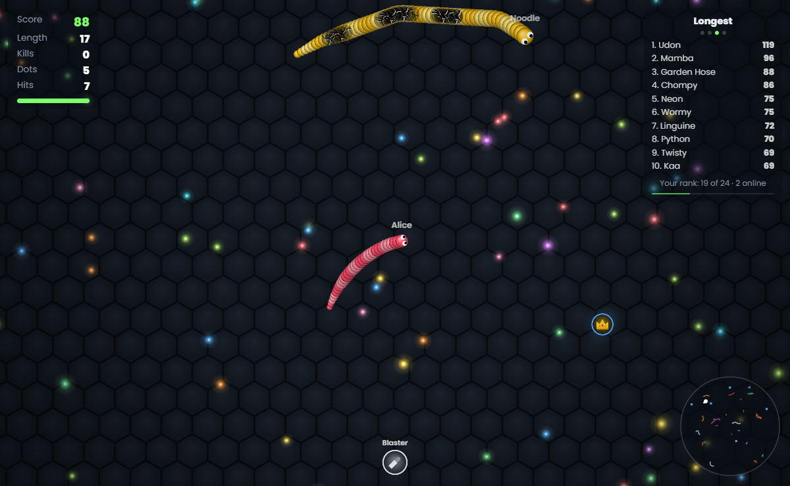
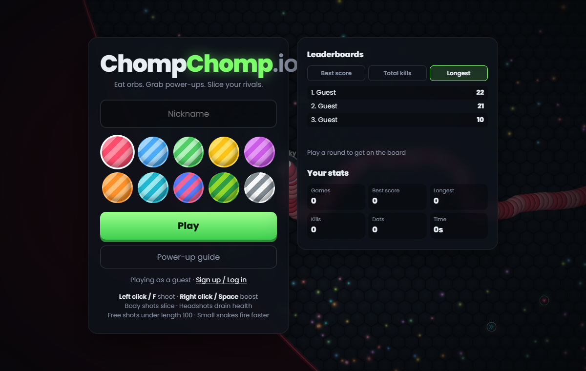

# ChompChomp.io: a multiplayer snake .io game with server-authoritative anti-cheat

**[▶ Play ChompChomp.io now](https://chompchompio.play.multiplayeragent.com/)**: free, in the browser, no download. Send the link to a friend and you're in the same arena.

ChompChomp.io is a slither-style browser game where snakes have guns. Eat glowing orbs to grow, grab power-ups and weapons, shoot rivals' bodies to slice them in half, and chomp anyone who crosses your path. It runs online with friends, with player accounts, saved stats, global leaderboards, and bots that fill the world and step aside as real players join.

It was built with [Claude Code](https://claude.com/claude-code) and the [Multiplayer Agent](https://multiplayeragent.com/) plugin, starting from a single-player canvas game and turning it into a hosted multiplayer game. Multiplayer Agent runs the game server and hosts the share link. This repo is the full source, and it's part of the content package for the video made while building it.



## Features

- **Real-time multiplayer:** everyone who opens the link plays in the same arena, synced 20 times a second.
- **Server-authoritative anti-cheat:** the server decides movement, dots, power-ups, bullets, damage and scores. The browser only sends steering, boost and fire. You can't teleport, spawn power-ups, or fake a score.
- **Player login:** you start as a guest instantly. Sign up to keep your progress and put your name on the leaderboards, and log in on any device.
- **Saved player data:** games played, best score, longest snake, total kills, dots eaten and time played, all written by the server.
- **Global leaderboards:** best score, total kills and longest snake, plus a live in-match leaderboard.
- **Bots that make room:** 24 bots keep an empty world lively. Three retire for every player who joins, out of sight.
- **7 weapons and 17 power-ups:** blaster, shotgun, twin guns, SMG, railgun, rocket launcher, homing seeker; shields, ghost mode, frenzy, vampire, nanobots and more.
- **Smooth netcode:** client-side prediction for your own snake and interpolation for everyone else, so steering feels instant.
- **Desktop and mobile:** mouse, keyboard or touch, with on-screen fire and boost buttons.



## How to play

| Action | Desktop | Mobile |
| --- | --- | --- |
| Steer | Mouse | Drag |
| Shoot | Left click or `F` | FIRE button |
| Boost (costs length) | Right click, `Space` or `W` | BOOST button or two fingers |

Body shots slice snakes; headshots drain health. Shooting is free under length 100, and smaller snakes fire faster. Running your head into another snake's body ends your run, and the world's red edge is deadly.

## How the anti-cheat works

Most browser .io clones trust the client: the browser says where its snake is and what it ate. ChompChomp.io doesn't. The whole world is simulated on the server by [authoritative room logic](https://multiplayeragent.com/docs) running on Multiplayer Agent:

```
 browser                                   Multiplayer Agent room "arena" (server)
 ───────                                   ───────────────────────────────────────
 mouse / keys ──► input {angle, boost, fire} ──► onInput: queue it, one per tick
                                                 onTick: move snakes, eat orbs, fire bullets,
                                                         collide, kill, spawn/retire bots
 draws snakes ◄── room state (snake heads, mass, power-ups) ◄─┘
 draws orbs   ◄── events (orb added/eaten, bullet fired/hit, effects)
 stats screen ◄── saveData / submitScore (only the server writes these)
```

- Clients can't write room state. If a modified client sends fake "I ate this" or "I picked that up" messages, or sets its own position or mass, the server ignores it.
- Inputs are validated: a steering angle, two booleans, nothing else. Speed and turning come from the server's rules, so a snake can't teleport.
- Saves and leaderboard scores are written by the server from results it computed itself, so they can't be forged from the browser.
- Your own snake is predicted locally from your inputs and corrected against the server every tick, so it still feels instant.

## Play it right now

Clone the repo and open `index.html` in your browser. With no game key of its own, it runs offline: the same server logic
runs in your browser, against 21 bots, with your stats and bests saved on your device. No install, no build, no account.

## Make it yours

To play online with friends at your own share link, use [Claude Code](https://claude.com/claude-code) with the
[Multiplayer Agent plugin](https://github.com/multiplayeragent/multiplayer-agent):

```
/plugin marketplace add multiplayeragent/multiplayer-agent
/plugin install multiplayer-agent@multiplayer-agent
/multiplayer-agent:remix chompchomp-io
```

Or just ask it to "remix ChompChomp.io". It makes your own game, wires up its key, deploys the server logic and publishes
your copy. You don't need an account to start, and the [free tier](https://multiplayeragent.com/pricing) is enough to
play with friends.

By hand, in a clone of this repo:

1. Create a game with `create_game`, copy [mp.config.local.example.js](mp.config.local.example.js) to
   `mp.config.local.js`, and replace `pk_REPLACE_ME` in it with your game's publishable key (`pk_…`). It's gitignored,
   so your key never ends up in a commit. [mp.config.js](mp.config.js) keeps the placeholder that makes the game run offline.
2. Build the server bundle with `node build.js` (Node 18+, no dependencies). This writes `dist/server.js`.
3. Deploy it with `deploy_room_logic` to the room `arena`, at tick rate 20. Server logic needs a Multiplayer Agent
   account; Claude opens the sign-in page for you.
4. Publish `index.html`, `style.css`, `mp.config.js`, `mp.config.local.js`, `powerups.js`, `sim.js`, `local.js` and
   `game.js` with `publish_game`, which gives you a share link at `https://<your-game>.play.multiplayeragent.com/`.

## Project structure

| File | What it does |
| --- | --- |
| [game.js](game.js) | Browser client: rendering, input, prediction and interpolation, accounts, leaderboards, menus |
| [sim.js](sim.js) | Game rules shared by server and client: movement, food, power-ups, bullets, collisions, bot AI |
| [powerups.js](powerups.js) | Weapon and power-up definitions and their icons |
| [server/logic.js](server/logic.js) | Authoritative room logic: inputs, ticks, state sync, events, saves and leaderboard scores |
| [local.js](local.js) | Offline play: runs `server/logic.js` in the browser when the game has no key of its own |
| [mp.config.js](mp.config.js) | Game key and endpoints. The committed key is a placeholder; your real one goes in `mp.config.local.js` |
| [mp.config.local.example.js](mp.config.local.example.js) | Copy it to `mp.config.local.js` (gitignored) and put your key in it |
| [AGENTS.md](AGENTS.md) | Directions for coding agents: the placeholders to replace (marked `REPLACE_ME`) and the rules for keys and emails |
| [build.js](build.js) | Bundles `powerups.js` + `sim.js` + `server/logic.js` into `dist/server.js` for deployment |
| [index.html](index.html), [style.css](style.css) | Page, HUD and menus |

## Built with Multiplayer Agent

[Multiplayer Agent](https://multiplayeragent.com/) is a hosted backend that makes any browser game multiplayer, driven from Claude Code through its [MCP server](https://multiplayeragent.com/mcp). ChompChomp.io uses:

- **Realtime rooms** for the shared arena state and events
- **Authoritative server logic** for anti-cheat
- **Player identity** for guest play, sign up and log in
- **Player datastore** for saved stats
- **Leaderboards** for best score, total kills and longest
- **Hosting** for the share link

Links:

- Multiplayer Agent: https://multiplayeragent.com/
- Claude Code plugin and MCP server: https://github.com/multiplayeragent/multiplayer-agent
- How the MCP connection works: https://multiplayeragent.com/mcp
- SDK reference: https://multiplayeragent.com/docs
- Pricing (free tier, no card): https://multiplayeragent.com/pricing
- Play ChompChomp.io: https://chompchompio.play.multiplayeragent.com/

## License

[MIT](LICENSE)
